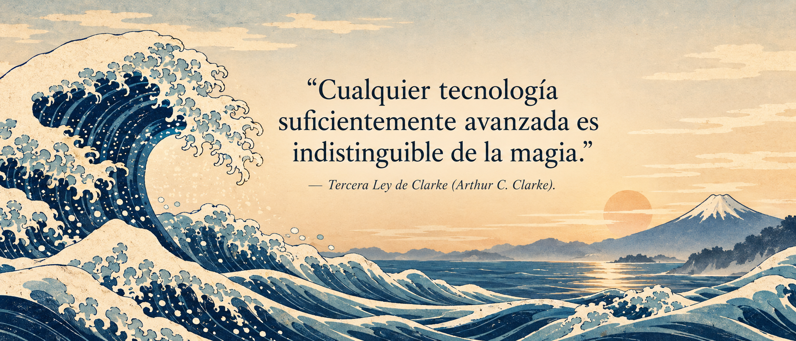
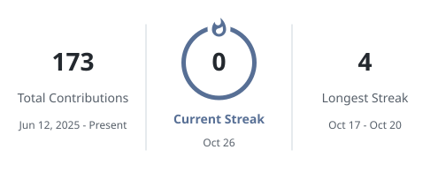

<h1 data-importer="text" align="center">Hey 👋 Soy Ángel Menendez</h1>

<h3 data-importer="text" align="center">Desarrollador de software · AngelmzDev</h3>

Herramientas útiles, automatización y aplicaciones que resuelven tareas cotidianas.

###

  
  
  
  
  

###

<h2 data-importer="text" align="center">☕ Mi foco actual: Java</h2>

  

Actualmente estoy centrado en Java: lógica de programación, fundamentos y programación orientada a objetos.

  

###

<h2 data-importer="text" align="center">🧭 Ruta tecnológica · DAM</h2>

  
  
  
  
  

Java · SQL · React · React Native

Java es mi foco actual. SQL, React y React Native forman parte de la ruta del ciclo; esta sección describe el recorrido técnico, no un dominio acreditado de todas las tecnologías.

<strong>📚 Ver el recorrido completo de DAM · CES Juan Pablo II</strong>

Los contenidos siguientes corresponden al programa publicado por el centro. No representan competencias ya completadas.

| Primer curso | Segundo curso |
| :--- | :--- |
| Lenguajes de marcas y gestión de información | Acceso a datos |
| Sistemas informáticos | Desarrollo de interfaces |
| Bases de datos | Programación multimedia y dispositivos móviles |
| Programación | Programación de servicios y procesos |
| Entornos de desarrollo | Sistemas de gestión empresarial · ERP/CRM |
| Inglés profesional | Itinerario personal para la empleabilidad II |
| Digitalización aplicada al sector productivo | Optatividad |
| Sostenibilidad aplicada al sistema productivo | Proyecto intermodular |
| Itinerario personal para la empleabilidad I | |
| Proyecto intermodular | |

El recorrido abarca aplicaciones, interfaces, datos, servicios, multimedia, dispositivos móviles y gestión empresarial.

Fuentes: [programa oficial del centro](https://cesjuanpablosegundo.es/cursos/grado-superior-en-desarrollo-de-aplicaciones-multiplataforma/) · [SQL, React y React Native en DAM](https://cesjuanpablosegundo.es/estudia-desarrollo-de-aplicaciones-multiplataforma-dam/).

###

<h2 data-importer="text" align="center">🚀 Proyectos que he construido</h2>

| Proyecto | Para qué sirve | Ver más |
| :--- | :--- | :--- |
| 🪟 **Awtop** | Elige una ventana de Windows y mantenla visible sobre las demás mientras trabajas. | [Código y uso ↗](https://github.com/AngelmzDev/Awtop) |
| 🎬 **Automatización de vídeos** | Prepara un flujo de generación de contenido a partir de un título y una duración. | [Descripción ↗](https://angelmzdev.github.io/#projects) |
| ⚡ **Extensión para Meta.ai** | Automatiza el envío de prompts preparados para reducir tareas repetitivas. | [Descripción ↗](https://angelmzdev.github.io/#projects) |

Parto de necesidades concretas y utilizo IA como apoyo para crear prototipos, explorar soluciones y documentar el proceso.

###

<h2 data-importer="text" align="center">📊 Mi actividad en GitHub</h2>

  

  <a href="https://github.com/AngelmzDev?tab=overview">
    <picture>
      <source media="(prefers-color-scheme: dark)" srcset="assets/streak-dark.svg" />
      
    </picture>
  </a>

###

<h2 data-importer="text" align="center">🎙️ Café y Bytes · Hablemos</h2>

Comparto contenido sobre tecnología, automatización y programación en Café y Bytes. Para conversar sobre mis proyectos u oportunidades de desarrollo de software, tienes mis enlaces de contacto arriba.

<!-- The streak cards are refreshed daily by .github/workflows/update-streak.yml. -->

